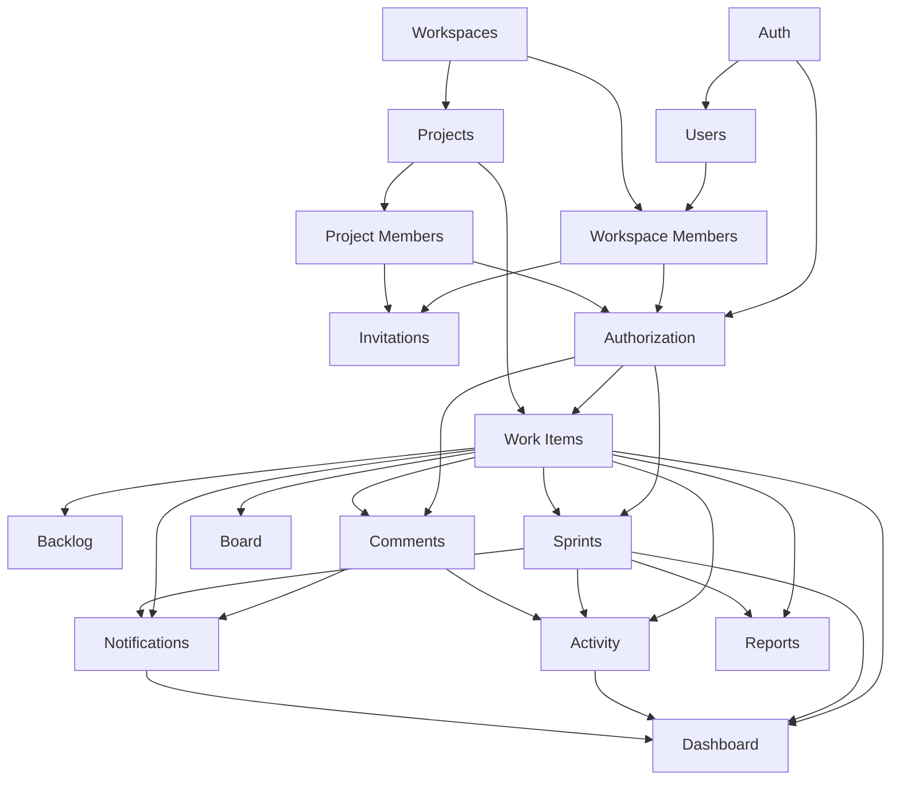

# Features and Modules

**Product:** Project Management SaaS  
**Document:** FEATURES_AND_MODULES.md  
**Version:** 1.0  
**Status:** Initial Draft  
**Last Updated:** October 31, 2026

---

# 1. Purpose

This document defines the application's functional modules, their responsibilities, features, dependencies, and boundaries.

It serves as a bridge between the Product Requirements Document (PRD) and the technical implementation.

It should help developers understand:

- Which modules are required.
- What each module is responsible for.
- Which features belong to each module.
- How modules interact.
- Which modules depend on other modules.
- Which modules should be implemented first.
- Which functionality belongs in the MVP and which should come later.

This document describes the logical application architecture, not the final database schema or API implementation.

---

# 2. Application Architecture Overview

The application will follow a **modular monolith architecture** initially.

A modular monolith means the application runs as one deployable system but is divided into independent functional modules with clearly defined responsibilities.

Each module should own its business logic and expose functionality through well-defined interfaces.

## 2.1 High-Level Module Structure

The application is divided into the following modules:

| Module | Responsibility | Priority |
|---|---|---|
| Auth | Authentication and sessions | P0 |
| Users | User profiles and account management | P0 |
| Workspaces | Workspace creation and management | P0 |
| Workspace Members | Workspace membership and roles | P0 |
| Invitations | Workspace and project invitations | P0 |
| Projects | Project creation and management | P0 |
| Project Members | Project membership and permissions | P0 |
| Work Items | Tasks, stories, bugs, epics, and subtasks | P0 |
| Backlog | Backlog organization and prioritization | P0 |
| Sprints | Sprint planning and execution | P0 |
| Board | Kanban board and task movement | P0 |
| Comments | Task discussions and collaboration | P0 |
| Activity | Project and resource activity history | P0 |
| Notifications | In-app notifications | P0 |
| Dashboard | User and project overview | P0 |
| Reports | Basic project and sprint reporting | P0 |
| Search | Global and project-specific search | P1 |
| Attachments | File upload and management | P1 |
| Labels | Task labels and categorization | P1 |
| Calendar | Calendar-based project views | P1 |
| Roadmaps | Long-term planning and milestones | P2 |
| Dependencies | Task dependency management | P2 |
| Time Tracking | Work duration tracking | P2 |
| Automation | Configurable automated actions | P2 |
| Integrations | External application integrations | P2 |
| AI Assistant | AI-powered project assistance | P3 |
| Billing | Plans, subscriptions, and payments | P3 |

Priority definitions:

- **P0:** Required for MVP.
- **P1:** Important post-MVP functionality.
- **P2:** Advanced functionality.
- **P3:** Long-term functionality.

---

# 3. Core Application Modules

## 3.1 Authentication Module

**Module:** `auth`  
**Priority:** P0

### Responsibility

Handles user authentication, session management, and account security.

This module is responsible for verifying the identity of users.

It does not own workspace or project permissions.

### Features

#### Registration
- Register a new user.
- Validate registration information.
- Check email uniqueness.
- Hash passwords securely.
- Create user credentials.
- Support email verification.

#### Login
- Authenticate users.
- Validate credentials.
- Establish a secure session.
- Handle invalid login attempts.

#### Logout
- Invalidate the current session.
- Clear authentication cookies or tokens.
- Redirect users appropriately.

#### Password Management
- Request password reset.
- Generate password reset tokens.
- Validate reset tokens.
- Update passwords.
- Expire and invalidate used tokens.

#### Session Management
- Create sessions.
- Validate sessions.
- Refresh sessions where applicable.
- Revoke sessions.
- Handle expired sessions.

### Dependencies

- Users.
- Email delivery provider.

### Module Boundary

The Auth module answers:

**"Who is this user?"**

It does not answer:

- Which workspace can the user access?
- Which project can the user access?
- Can the user update a task?

Those responsibilities belong to authorization and domain modules.

---

## 3.2 Users Module

**Module:** `users`  
**Priority:** P0

### Responsibility

Manages user account information and profile data.

### Features

- Get current user.
- Get user profile.
- Update user name.
- Update profile image.
- Change account details.
- Change password through the authentication flow.
- Manage basic user preferences.
- Deactivate account where supported.

### Dependencies

- Auth.
- Notifications.

### Module Boundary

The Users module owns user profile information.

It does not own workspace membership or project membership.

A user profile and a user's membership in a workspace are separate concepts.

---

## 3.3 Workspaces Module

**Module:** `workspaces`  
**Priority:** P0

### Responsibility

Manages workspace creation, configuration, ownership, and workspace-level information.

### Features

#### Workspace Creation
- Create workspace.
- Generate workspace slug.
- Validate unique slug.
- Assign creator as Workspace Owner.

#### Workspace Management
- Get workspace details.
- Update workspace name.
- Update workspace description.
- Update workspace logo.
- Update workspace settings.
- Archive or delete workspace according to policy.

#### Workspace Overview
- Get workspace summary.
- Get accessible projects.
- Get member count.
- Get recent workspace activity.

#### Workspace Switching
- Get user's accessible workspaces.
- Switch active workspace context.
- Validate workspace access.

### Dependencies

- Auth.
- Users.
- Workspace Members.
- Projects.

### Module Boundary

The Workspaces module owns workspace-level information.

It must not automatically grant access to all projects within a workspace.

---

## 3.4 Workspace Members Module

**Module:** `workspace-members`  
**Priority:** P0

### Responsibility

Manages the relationship between users and workspaces.

### Features

- Add workspace members.
- List workspace members.
- Get workspace member details.
- Update workspace roles.
- Remove workspace members.
- Check workspace membership.
- Validate workspace-level permissions.

### Workspace Roles

- Owner.
- Admin.
- Member.

### Important Rules

- A user may belong to multiple workspaces.
- A user must not be added twice to the same workspace.
- Every workspace must have an authorized owner.
- Workspace roles must not automatically become project roles.
- Removing a workspace member must follow the defined project-membership policy.

### Dependencies

- Auth.
- Users.
- Workspaces.
- Invitations.

### Module Boundary

This module manages workspace membership only.

It does not manage project membership.

---

## 3.5 Invitations Module

**Module:** `invitations`  
**Priority:** P0

### Responsibility

Manages invitations for joining workspaces and projects.

The invitation module provides a common invitation lifecycle, while the target resource determines the membership that is created after acceptance.

### Features

- Create invitation.
- Generate secure invitation token.
- Send invitation email.
- Get invitation details.
- Validate invitation.
- Accept invitation.
- Reject invitation.
- Cancel invitation.
- Resend invitation.
- Expire invitations.
- List pending invitations.

### Invitation Types

#### Workspace Invitation

Contains:

- Workspace reference.
- Invitee email.
- Workspace role.
- Inviter.
- Invitation status.
- Expiration.

On acceptance, it creates workspace membership.

#### Project Invitation

Contains:

- Project reference.
- Invitee email.
- Project role.
- Inviter.
- Invitation status.
- Expiration.

On acceptance, it creates project membership.

### Invitation Lifecycle

`Pending → Accepted`

Other possible terminal states:

- Rejected.
- Cancelled.
- Expired.

### Dependencies

- Auth.
- Users.
- Workspaces.
- Workspace Members.
- Projects.
- Project Members.
- Email provider.

### Module Boundary

Invitations manages the invitation lifecycle.

It should not independently implement workspace or project permission rules.

The relevant membership module must validate and create the membership.

---

## 3.6 Projects Module

**Module:** `projects`  
**Priority:** P0

### Responsibility

Manages project creation, configuration, ownership, visibility, and lifecycle.

### Features

#### Project Creation
- Create project.
- Generate project key.
- Validate project key uniqueness within the workspace.
- Set initial visibility.
- Assign creator as Project Admin.
- Initialize default workflows.

#### Project Management
- Get project details.
- Update project name.
- Update project description.
- Update project icon.
- Update project visibility.
- Update project dates.
- Archive project.
- Restore project.
- Delete project according to policy.

#### Project Overview
- Get project summary.
- Get project statistics.
- Get active sprint.
- Get project activity.
- Get project member information.

#### Ownership Management
- Transfer Project Admin ownership.
- Validate new owner.
- Preserve the single-admin invariant.

### Dependencies

- Auth.
- Workspaces.
- Workspace Members.
- Project Members.
- Work Items.
- Sprints.
- Activity.

### Critical Rules

- A project belongs to exactly one workspace.
- A project must have exactly one Project Admin.
- A project creator becomes its initial Project Admin.
- Project ownership transfer must be atomic.
- Project visibility must not bypass authorization.
- A project cannot be left without an Admin.

### Module Boundary

Projects owns project-level information and lifecycle.

Project membership and detailed permission checks belong to Project Members and Authorization.

---

## 3.7 Project Members Module

**Module:** `project-members`  
**Priority:** P0

### Responsibility

Manages project membership, project roles, and project-level access relationships.

### Features

- Add project members.
- List project members.
- Get project member details.
- Update project roles.
- Remove project members.
- Validate project membership.
- Check whether a user is an active project member.
- Validate Project Admin ownership.
- Transfer project ownership through an authorized operation.

### Project Roles

- Admin.
- Manager.
- Member.
- Viewer.

### Important Rules

- Project membership is independent of workspace membership.
- A project member must belong to the relevant workspace under the current membership policy.
- Project roles must not be confused with workspace roles.
- A project must have exactly one Project Admin.
- A removed member must immediately lose access.
- Existing comments and activity records must remain after removal.

### Dependencies

- Auth.
- Users.
- Workspaces.
- Workspace Members.
- Projects.
- Invitations.

### Module Boundary

This module owns project membership.

It should expose membership and role-checking operations to other modules rather than requiring them to query membership records independently.

---

## 3.8 Authorization Module

**Module:** `authorization`  
**Priority:** P0

### Responsibility

Provides centralized authorization policies for the entire application.

Authentication determines the user's identity.

Authorization determines what that user is allowed to do.

### Features

- Validate authenticated access.
- Validate workspace access.
- Validate workspace role permissions.
- Validate project membership.
- Validate project role permissions.
- Validate resource ownership.
- Validate task-level permissions.
- Validate access to nested resources.
- Enforce workspace and project isolation.

### Example Authorization Checks

```ts
canAccessWorkspace(userId, workspaceId)

canManageWorkspaceMembers(userId, workspaceId)

canAccessProject(userId, projectId)

canManageProject(userId, projectId)

canCreateTask(userId, projectId)

canUpdateTask(userId, taskId)

canManageSprint(userId, projectId)
```

These are conceptual operations. Their final signatures should be decided during technical design.

### Important Rules

- All authorization checks must be enforced on the server.
- Frontend visibility is not a security boundary.
- Resource IDs must not be trusted.
- Related resources must be validated against the same project.
- Authorization must be checked for every protected operation.

### Dependencies

- Auth.
- Users.
- Workspaces.
- Workspace Members.
- Projects.
- Project Members.

### Module Boundary

Authorization should provide reusable policy decisions.

Individual domain modules remain responsible for executing their own business operations.

For example, Authorization decides whether a user can update a task; Work Items performs the task update.

---

# 4. Work Management Modules

## 4.1 Work Items Module

**Module:** `work-items`  
**Priority:** P0

### Responsibility

Manages all project work items.

This module is the central domain module for task-related functionality.

### Work Item Types

- Epic.
- Story.
- Task.
- Bug.
- Improvement.
- Subtask.

### Features

#### Work Item Creation
- Create work item.
- Generate project-specific identifier.
- Validate work item type.
- Set initial status.
- Set initial priority.
- Associate with an epic.
- Associate with a parent item.

#### Work Item Management
- Get work item details.
- Update work item.
- Delete work item.
- Archive work item if supported.
- Search work items.
- Filter work items.
- Sort work items.

#### Assignment
- Assign work item.
- Reassign work item.
- Add collaborators if supported.
- Remove collaborators.
- Validate assignee membership.

#### Work Item Status
- Update status.
- Validate workflow transition.
- Record status changes.
- Return work item to backlog where appropriate.

#### Hierarchy
- Create parent-child relationship.
- Remove parent-child relationship.
- Link work item to epic.
- Get child items.
- Get parent item.
- Validate hierarchy rules.
- Prevent circular relationships.

#### Priority and Estimation
- Update priority.
- Update story points.
- Update estimates.
- Track due dates.

### Default Priorities

- Urgent.
- High.
- Medium.
- Low.
- None.

### Default Statuses

- Backlog.
- To Do.
- In Progress.
- In Review.
- Done.
- Blocked (optional).
- Cancelled (optional).

### Dependencies

- Auth.
- Authorization.
- Projects.
- Project Members.
- Backlog.
- Sprints.
- Comments.
- Activity.
- Notifications.
- Labels.
- Attachments.

### Module Boundary

Work Items owns task and work item business logic.

The Board and Backlog modules should consume Work Items functionality rather than implementing separate task update logic.

---

## 4.2 Backlog Module

**Module:** `backlog`  
**Priority:** P0

### Responsibility

Manages the organization and ordering of project work that is not currently being executed.

### Features

- Get project backlog.
- Add work items to backlog.
- Remove work items from backlog.
- Reorder backlog items.
- Prioritize backlog items.
- Filter backlog items.
- Search backlog items.
- Move items into a sprint.
- Move incomplete sprint items back to backlog.

### Rules

- Backlog items must belong to the same project.
- Backlog ordering must persist.
- A work item must not belong to multiple active sprints.
- Backlog operations must respect project permissions.
- Sprint assignment must update the relevant work item relationship consistently.

### Dependencies

- Auth.
- Authorization.
- Projects.
- Project Members.
- Work Items.
- Sprints.

### Module Boundary

Backlog owns backlog-specific ordering and organization.

It does not own the task's title, description, priority, or core task details.

---

## 4.3 Sprints Module

**Module:** `sprints`  
**Priority:** P0

### Responsibility

Manages sprint planning, lifecycle, execution, and completion.

### Features

#### Sprint Creation
- Create sprint.
- Update sprint name.
- Update sprint goal.
- Update sprint dates.
- Delete or cancel sprint where permitted.

#### Sprint Planning
- Add backlog items.
- Remove sprint items.
- Reorder sprint items.
- Review sprint scope.
- Review task estimates.
- Review assigned workload.

#### Sprint Lifecycle
- Start sprint.
- Complete sprint.
- Cancel sprint.
- Validate lifecycle transitions.

#### Sprint Execution
- Get active sprint.
- Get sprint work items.
- Track completed work.
- Track incomplete work.
- Track sprint progress.

#### Sprint Completion
- Identify completed items.
- Identify incomplete items.
- Move incomplete items to backlog or another eligible sprint.
- Preserve sprint history.
- Generate sprint summary.

### Sprint States

- Planning.
- Ready.
- Active.
- Completed.
- Cancelled.

### Critical Rules

- A sprint belongs to one project.
- Sprint work items must belong to the same project.
- One active sprint per project is the default policy.
- Sprint lifecycle transitions must be validated.
- Incomplete work must never be silently discarded.
- Sprint activation must handle concurrent requests safely.

### Dependencies

- Auth.
- Authorization.
- Projects.
- Project Members.
- Work Items.
- Backlog.
- Activity.
- Notifications.
- Reports.

### Module Boundary

Sprints owns sprint lifecycle and sprint planning operations.

Work Items owns the task details and task status.

---

## 4.4 Board Module

**Module:** `board`  
**Priority:** P0

### Responsibility

Provides a visual representation of project work items grouped by status.

### Features

- Get board columns.
- Get board work items.
- Group items by status.
- Drag-and-drop movement.
- Reorder items where supported.
- Filter board items.
- Search board items.
- Open task details.

### Default Columns

- Backlog.
- To Do.
- In Progress.
- In Review.
- Done.

### Rules

- Board movement must validate the target workflow status.
- Board operations must validate permissions.
- Changes must be persisted.
- Failed operations must restore or reconcile the displayed state.
- Board data must be restricted to the current project.

### Dependencies

- Auth.
- Authorization.
- Projects.
- Project Members.
- Work Items.
- Sprints.

### Module Boundary

The Board module is primarily a presentation and workflow coordination module.

It must not create a second independent source of truth for task status.

The Work Items module owns the actual status update operation.

---

# 5. Collaboration Modules

## 5.1 Comments Module

**Module:** `comments`  
**Priority:** P0

### Responsibility

Manages comments and discussions attached to project resources.

### Features

- Create comment.
- List comments.
- Update comment.
- Delete comment.
- Mention project members.
- Notify mentioned users.
- Validate resource access.

### Initial Scope

MVP comments are primarily task-level comments.

Future versions may support:

- Project discussions.
- Epic comments.
- Sprint discussions.
- Rich text.
- Reactions.
- Threaded replies.

### Dependencies

- Auth.
- Authorization.
- Projects.
- Project Members.
- Work Items.
- Notifications.
- Activity.

### Module Boundary

Comments owns comment content and lifecycle.

It does not own notification delivery or activity history.

---

## 5.2 Activity Module

**Module:** `activity`  
**Priority:** P0

### Responsibility

Maintains a historical record of important actions across the application.

### Features

- Record activity.
- Get project activity.
- Get task activity.
- Get workspace activity where permitted.
- Filter activity.
- Paginate activity.
- Display activity descriptions.

### Activity Events

Examples:

- Project created.
- Project updated.
- Ownership transferred.
- Member added.
- Member removed.
- Role changed.
- Task created.
- Task updated.
- Task assigned.
- Task status changed.
- Comment added.
- Sprint created.
- Sprint started.
- Sprint completed.

### Rules

- Activity records must contain an actor and timestamp.
- Activity records must reference the affected resource.
- Historical records must not be editable through ordinary user operations.
- Activity must respect resource access permissions.

### Dependencies

- Auth.
- Authorization.
- Workspaces.
- Projects.
- Project Members.
- Work Items.
- Sprints.
- Comments.

### Module Boundary

Activity owns historical event records.

It should not own the actual business operation that generated the event.

---

## 5.3 Notifications Module

**Module:** `notifications`  
**Priority:** P0

### Responsibility

Manages user-facing notifications.

### Features

- Create notification.
- List user notifications.
- Get unread notification count.
- Mark notification as read.
- Mark all notifications as read.
- Navigate to related resources.
- Validate recipient access.
- Prevent duplicate notifications where appropriate.

### Notification Events

- Workspace invitation.
- Project invitation.
- Task assignment.
- Task reassignment.
- Mention.
- Sprint started.
- Sprint completed.
- Ownership transfer.
- Relevant membership changes.

### Notification Types

- Workspace.
- Project.
- Task.
- Comment.
- Sprint.
- System.

### Dependencies

- Auth.
- Users.
- Authorization.
- Invitations.
- Workspaces.
- Projects.
- Project Members.
- Work Items.
- Comments.
- Sprints.

### Module Boundary

Notifications owns notification records and read/unread state.

External email delivery should be handled through a dedicated delivery adapter or service.

---

# 6. Dashboard and Reporting Modules

## 6.1 Dashboard Module

**Module:** `dashboard`  
**Priority:** P0

### Responsibility

Aggregates information from other modules to present useful summaries.

### Features

#### User Dashboard
- Assigned tasks.
- Tasks due soon.
- Overdue tasks.
- Recent projects.
- Recent notifications.
- Relevant activity.

#### Workspace Dashboard
- Project count.
- Member count.
- Recent workspace activity.
- Accessible projects.

#### Project Dashboard
- Total tasks.
- Completed tasks.
- In-progress tasks.
- Overdue tasks.
- Active sprint.
- Recent activity.
- Project members.

### Dependencies

- Auth.
- Authorization.
- Workspaces.
- Projects.
- Project Members.
- Work Items.
- Sprints.
- Activity.
- Notifications.

### Module Boundary

Dashboard is an aggregation module.

It should not own the source data or independently mutate the business entities it displays.

---

## 6.2 Reports Module

**Module:** `reports`  
**Priority:** P0 for basic reports

### Responsibility

Generates project and sprint progress summaries.

### Features

#### Project Reports
- Task count by status.
- Task count by priority.
- Completed work.
- Overdue work.
- Work distribution by assignee.

#### Sprint Reports
- Planned work.
- Completed work.
- Incomplete work.
- Carryover work.
- Completion percentage.

### Future Features

- Burndown charts.
- Velocity charts.
- Cycle time.
- Lead time.
- Workload analysis.
- Historical comparisons.

### Dependencies

- Auth.
- Authorization.
- Projects.
- Project Members.
- Work Items.
- Sprints.

### Module Boundary

Reports reads and aggregates domain data.

It must not become the source of truth for task or sprint state.

---

# 7. Supporting Modules

These modules support the core experience but may be implemented after the initial MVP foundations.

## 7.1 Labels Module

**Module:** `labels`  
**Priority:** P1

Responsibilities:

- Create project labels.
- Update labels.
- Delete labels.
- Assign labels to work items.
- Remove labels from work items.
- Filter tasks by labels.

Labels must be scoped to the appropriate project.

## 7.2 Attachments Module

**Module:** `attachments`  
**Priority:** P1

Responsibilities:

- Upload files.
- Validate file types.
- Validate file size.
- Store file metadata.
- Generate secure download access.
- Delete attachments.
- Associate attachments with project resources.

File storage should be abstracted behind a storage service so the provider can change later.

## 7.3 Search Module

**Module:** `search`  
**Priority:** P1

Responsibilities:

- Search projects.
- Search tasks.
- Search epics.
- Search members where permitted.
- Search comments where supported.
- Provide filtered results.
- Enforce authorization on every result.

Search must never expose inaccessible resources.

## 7.4 Calendar Module

**Module:** `calendar`  
**Priority:** P1

Responsibilities:

- Display task due dates.
- Display sprint dates.
- Display project milestones.
- Filter calendar items.
- Navigate between time periods.

## 7.5 Roadmaps Module

**Module:** `roadmaps`  
**Priority:** P2

Responsibilities:

- Create roadmaps.
- Create milestones.
- Associate epics with milestones.
- Track long-term progress.
- Display planned delivery timelines.

## 7.6 Dependencies Module

**Module:** `dependencies`  
**Priority:** P2

Responsibilities:

- Create task dependencies.
- Remove dependencies.
- Identify blocked tasks.
- Prevent circular dependencies.
- Display dependency relationships.

Potential dependency types:

- Blocks.
- Is blocked by.
- Relates to.

## 7.7 Time Tracking Module

**Module:** `time-tracking`  
**Priority:** P2

Responsibilities:

- Start and stop timers.
- Record work duration.
- Add manual time entries.
- View time logs.
- Generate time reports.

## 7.8 Automation Module

**Module:** `automation`  
**Priority:** P3

Responsibilities:

- Define triggers.
- Define conditions.
- Define actions.
- Execute automated workflows.
- Track execution history.

Example:

When a task becomes overdue, notify the assigned user.

## 7.9 Integrations Module

**Module:** `integrations`  
**Priority:** P3

Responsibilities:

- Connect external services.
- Manage integration credentials.
- Synchronize supported resources.
- Receive external webhooks.
- Maintain integration logs.

Potential integrations:

- GitHub.
- GitLab.
- Slack.
- Microsoft Teams.
- Google Calendar.

## 7.10 AI Assistant Module

**Module:** `ai-assistant`  
**Priority:** P3

Responsibilities:

- Generate task descriptions.
- Summarize project activity.
- Summarize sprints.
- Identify project risks.
- Suggest sprint planning improvements.
- Answer questions about authorized project data.

AI access must follow the same workspace and project authorization policies as normal users.

## 7.11 Billing Module

**Module:** `billing`  
**Priority:** P3

Responsibilities:

- Manage subscription plans.
- Manage subscriptions.
- Track plan limits.
- Process payment provider webhooks.
- Manage billing information.
- Handle subscription changes.
- Support cancellations.

Billing should be introduced only after the product's commercial model is defined.

---

# 8. Shared Application Infrastructure

Not every application responsibility should be implemented as a business module.

The following infrastructure services support multiple modules.

| Infrastructure | Responsibility |
|---|---|
| Validation | Validate request and domain input |
| Database | Database connections and transaction handling |
| Authorization | Shared permission policies |
| Email | Email delivery abstraction |
| File Storage | File upload and retrieval abstraction |
| Logging | Application and error logs |
| Error Handling | Consistent application errors |
| Configuration | Environment variables and application settings |
| Rate Limiting | Protect sensitive and expensive operations |
| Pagination | Shared pagination conventions |
| API Responses | Consistent response structure |
| Audit Support | Record important security-sensitive events |

These should be shared through controlled interfaces.

Avoid turning the shared infrastructure directory into a place for unrelated business logic.

---

# 9. Module Dependencies

The following diagram illustrates the main domain dependencies.



This is a logical dependency diagram, not a requirement to create direct imports between every connected module.

Prefer interfaces, application services, and domain events where appropriate.

---

# 10. Module Communication Rules

To keep the application maintainable, modules must follow consistent communication rules.

## 10.1 Module Ownership

Each module owns its business rules and operations.

Examples:

- Work Items owns task creation and task updates.
- Sprints owns sprint lifecycle operations.
- Project Members owns project membership.
- Authorization owns permission decisions.
- Notifications owns notification state.

Other modules must not duplicate these responsibilities.

## 10.2 Avoid Direct Database Access Across Modules

A module should not directly modify another module's data.

For example:

- Sprints should not independently update task records to change task details.
- Board should not directly write task status without going through Work Items.
- Notifications should not directly modify project membership.

Instead, use the owning module's exposed application operations.

## 10.3 Domain Events

Important business operations may publish events.

Examples:

| Event | Trigger |
|---|---|
| `workspace.created` | Workspace created |
| `workspace.member_added` | Workspace membership created |
| `project.created` | Project created |
| `project.member_added` | Project member added |
| `project.ownership_transferred` | Project ownership transferred |
| `work_item.created` | Work item created |
| `work_item.assigned` | Work item assigned |
| `work_item.status_changed` | Task status changed |
| `comment.created` | Comment created |
| `sprint.started` | Sprint started |
| `sprint.completed` | Sprint completed |

Potential consumers:

- Activity.
- Notifications.
- Reports.
- Analytics.

For the MVP, events can be handled synchronously inside the modular monolith where appropriate.

For critical operations requiring reliable event delivery, use a transaction-safe mechanism such as an outbox pattern when the architecture warrants it.

Do not introduce a message broker or background job system solely to implement this abstraction.

## 10.4 Avoid Circular Dependencies

Modules should not depend on each other in circular ways.

If two modules need shared information, introduce a stable interface or move genuinely shared logic into a suitable shared domain service.

---

# 11. Suggested Next.js Folder Structure

The following is a proposed application structure.

It is intended as a starting point. Exact filenames and route organization will be finalized in `TECH_STACK_AND_ARCHITECTURE.md` and `API_DESIGN.md`.

```text
src/
│
├── app/
│   ├── (auth)/
│   │   ├── login/
│   │   ├── register/
│   │   └── forgot-password/
│   │
│   ├── (dashboard)/
│   │   ├── home/
│   │   ├── workspaces/
│   │   ├── my-tasks/
│   │   └── notifications/
│   │
│   ├── (workspace)/
│   │   └── [workspaceId]/
│   │       ├── overview/
│   │       ├── projects/
│   │       ├── members/
│   │       └── settings/
│   │
│   ├── (project)/
│   │   └── [workspaceId]/
│   │       └── [projectId]/
│   │           ├── overview/
│   │           ├── board/
│   │           ├── backlog/
│   │           ├── sprints/
│   │           ├── reports/
│   │           └── settings/
│   │
│   ├── invitations/
│   │   └── [token]/
│   │
│   ├── api/
│   │   └── ...
│   │
│   ├── layout.tsx
│   └── globals.css
│
├── modules/
│   │
│   ├── auth/
│   ├── users/
│   ├── workspaces/
│   ├── workspace-members/
│   ├── invitations/
│   ├── projects/
│   ├── project-members/
│   ├── authorization/
│   │
│   ├── work-items/
│   ├── backlog/
│   ├── sprints/
│   ├── board/
│   │
│   ├── comments/
│   ├── activity/
│   ├── notifications/
│   │
│   ├── dashboard/
│   ├── reports/
│   │
│   └── shared/
│
├── components/
│   ├── ui/
│   ├── layouts/
│   └── common/
│
├── lib/
│   ├── database/
│   ├── auth/
│   ├── email/
│   ├── storage/
│   ├── logger/
│   └── utils/
│
├── hooks/
│
├── config/
│
├── types/
│
└── middleware.ts
```

## 11.1 Suggested Module Internal Structure

Each business module should follow a consistent structure.

Example:

```text
modules/
└── work-items/
    │
    ├── components/
    │   ├── task-card.tsx
    │   ├── task-form.tsx
    │   ├── task-details.tsx
    │   └── task-filters.tsx
    │
    ├── schemas/
    │   └── work-item.schema.ts
    │
    ├── types/
    │   └── work-item.types.ts
    │
    ├── services/
    │   └── work-item.service.ts
    │
    ├── repositories/
    │   └── work-item.repository.ts
    │
    ├── actions/
    │   └── work-item.actions.ts
    │
    ├── hooks/
    │
    ├── constants/
    │   └── work-item.constants.ts
    │
    └── index.ts
```

Not every module needs every directory.

Create files only when they have a clear responsibility.

### Responsibilities

| Directory | Responsibility |
|---|---|
| `components` | Module-specific UI |
| `schemas` | Input and domain validation schemas |
| `types` | Module-specific TypeScript types |
| `services` | Business logic and use cases |
| `repositories` | Data access operations |
| `actions` | Server Actions or module entry points |
| `hooks` | Client-side reusable hooks |
| `constants` | Module-specific constants |
| `index.ts` | Public module exports |

The repository layer should be the only layer that directly handles persistence for that module.

---

# 12. Important Module Design Decisions

## 12.1 Work Items Instead of a Separate Task Module

The platform should use a central Work Items module rather than creating separate modules for tasks, stories, bugs, and epics.

Reason:

These work item types share common properties and behavior.

A shared module simplifies:

- Task creation.
- Assignment.
- Status management.
- Priority management.
- Search.
- Filtering.
- Activity history.
- Reporting.

Different work item types can have type-specific validation and behavior without duplicating the entire module.

## 12.2 Invitations as a Shared Module

Workspace and project invitations should share a common invitation lifecycle.

However, the resulting membership must be created by the correct membership module.

This avoids duplicating invitation-token and expiration logic.

## 12.3 Centralized Authorization

Authorization should not be implemented independently in every module.

A centralized policy layer should provide consistent decisions.

Domain modules must still validate their own business constraints.

## 12.4 Dashboard and Reports as Read-Oriented Modules

Dashboard and Reports should primarily aggregate data.

They should not become owners of the underlying task, project, or sprint data.

## 12.5 Board as a View Over Work Items

The Kanban Board should not maintain a separate task database or duplicate status information.

It is a different representation of the same work items.

---

# 13. Implementation Order

The implementation order should follow domain dependencies rather than UI navigation order.

## Phase 1 — Application Foundation

Modules:

- Auth.
- Users.
- Shared infrastructure.
- Database connection.
- Validation.
- Error handling.

Deliverables:

- Registration.
- Login.
- Logout.
- Session validation.
- Current user retrieval.
- Basic account settings.

## Phase 2 — Workspace Foundation

Modules:

- Workspaces.
- Workspace Members.
- Invitations.

Deliverables:

- Workspace creation.
- Workspace switching.
- Workspace member management.
- Workspace invitations.
- Workspace roles.

## Phase 3 — Project Foundation

Modules:

- Projects.
- Project Members.
- Authorization.

Deliverables:

- Project creation.
- Project overview.
- Project membership.
- Project role management.
- Project ownership transfer.
- Project-level access enforcement.

This phase must be completed before implementing project-specific resources.

## Phase 4 — Work Management

Modules:

- Work Items.
- Backlog.
- Board.

Deliverables:

- Work item creation.
- Task details.
- Assignment.
- Priority.
- Status.
- Basic hierarchy.
- Backlog.
- Kanban board.

## Phase 5 — Agile Workflows

Modules:

- Sprints.

Deliverables:

- Sprint creation.
- Sprint planning.
- Sprint activation.
- Sprint execution.
- Sprint completion.
- Incomplete work carryover.

## Phase 6 — Collaboration

Modules:

- Comments.
- Activity.
- Notifications.

Deliverables:

- Task comments.
- Mentions.
- Activity history.
- In-app notifications.

## Phase 7 — Dashboard and Reporting

Modules:

- Dashboard.
- Reports.

Deliverables:

- User dashboard.
- Project dashboard.
- Sprint summary.
- Basic project statistics.

## Phase 8 — Stabilization

Deliverables:

- Permission testing.
- Security testing.
- Integration testing.
- Performance review.
- Error handling review.
- Data consistency testing.
- MVP release preparation.

---

# 14. Module Testing Strategy

Every module must be tested according to its responsibilities.

| Module | Important Tests |
|---|---|
| Auth | Registration, login, session expiry, password reset |
| Users | Profile update, account validation |
| Workspaces | Creation, switching, workspace isolation |
| Workspace Members | Role changes, duplicate membership, removal |
| Invitations | Expiration, acceptance, duplicate acceptance |
| Projects | Creation, ownership, archive, visibility |
| Project Members | Role permissions, ownership transfer, removal |
| Authorization | Cross-workspace and cross-project access |
| Work Items | Creation, assignment, status transitions, hierarchy |
| Backlog | Ordering, sprint assignment |
| Sprints | Lifecycle, active sprint constraint, carryover |
| Board | Drag-and-drop validation, persistence |
| Comments | Access checks, edit permissions, mentions |
| Activity | Event recording and historical preservation |
| Notifications | Recipient validation, read/unread behavior |
| Dashboard | Data aggregation and access filtering |
| Reports | Correct calculations and project isolation |

Critical security and consistency rules should have automated tests.

---

# 15. MVP Module Checklist

## Foundation

- [ ] Auth
- [ ] Users
- [ ] Shared infrastructure
- [ ] Authorization

## Workspace

- [ ] Workspaces
- [ ] Workspace Members
- [ ] Invitations

## Project

- [ ] Projects
- [ ] Project Members

## Work Management

- [ ] Work Items
- [ ] Backlog
- [ ] Board
- [ ] Sprints

## Collaboration

- [ ] Comments
- [ ] Activity
- [ ] Notifications

## Reporting

- [ ] Dashboard
- [ ] Reports

## Stabilization

- [ ] Unit tests
- [ ] Integration tests
- [ ] Authorization tests
- [ ] Error handling
- [ ] Performance review

---

# 16. Guidelines for Future Module Development

When adding a new module, follow these rules:

1. Define its responsibility before implementing it.
2. Identify which module owns the data and business rules.
3. Define its dependencies.
4. Define its public operations.
5. Identify the authorization requirements.
6. Define validation rules.
7. Define expected errors.
8. Add tests for its business rules.
9. Avoid direct access to another module's internal implementation.
10. Update this document when module boundaries or responsibilities change.

A module should be introduced only when it represents a meaningful domain responsibility.

Do not create a separate module for every small UI component or utility function.

---

# 17. Final Module Architecture

The initial product should be built around these core domain boundaries:

**Identity and Access**
- Auth
- Users
- Authorization

**Workspace Management**
- Workspaces
- Workspace Members
- Invitations

**Project Management**
- Projects
- Project Members

**Work Management**
- Work Items
- Backlog
- Board
- Sprints

**Collaboration**
- Comments
- Activity
- Notifications

**Insights**
- Dashboard
- Reports

**Supporting Capabilities**
- Labels
- Attachments
- Search
- Calendar

**Future Capabilities**
- Roadmaps
- Dependencies
- Time Tracking
- Automation
- Integrations
- AI Assistant
- Billing

The initial architecture should remain a modular monolith with clear ownership, centralized authorization, and controlled communication between modules.

**The objective is to build a maintainable foundation where each module has one clear responsibility and future functionality can be introduced without compromising existing business rules.**